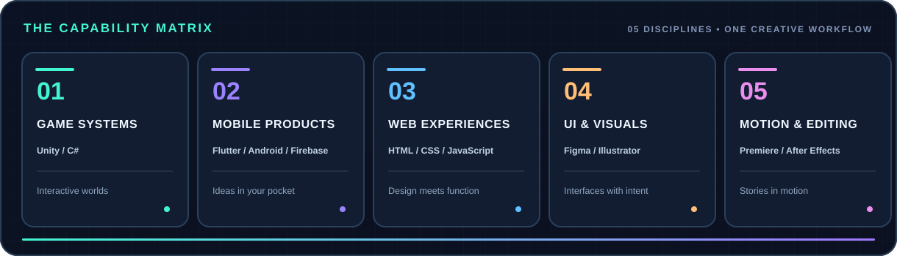
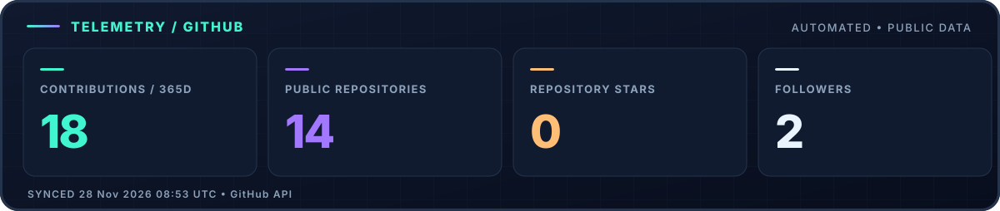
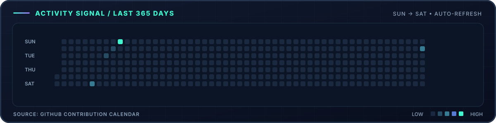

<!--
  CHAMATHKA // CREATOR OS
  Built for: https://github.com/ChamathkaGimhana
  Static artwork: assets/hero.svg and assets/capabilities.svg
  Auto-generated panels: output branch, updated by GitHub Actions
  All sections remain editable. Do not replace the output URLs with Platane's demo images.
-->

  

   

  <strong>Creative code. Intentional design. Experiences that feel alive.</strong>

  <a href="https://github.com/ChamathkaGimhana?tab=repositories"><b>EXPLORE MY CODE</b></a>
  &nbsp; • &nbsp;
  <a href="mailto:gimhanac32@gmail.com"><b>LET'S CREATE</b></a>
  &nbsp; • &nbsp;
  <a href="https://www.linkedin.com/in/chamathka-gimhana-geeth/"><b>LINKEDIN</b></a>

 

### `01 / WHO I AM`

I'm **Chamathka Gimhana**, a creative developer and indie creator from **Sri Lanka**. I enjoy the intersection of technology, interaction, and visual storytelling — from Unity gameplay and Android apps to expressive websites, carefully designed interfaces, and video content.

I don't want products to simply *work*. I want them to **feel good to use**.

> **MY CREATIVE LOOP:** Imagine → Prototype → Build → Refine → Ship.

### `02 / MY CREATIVE UNIVERSE`

  

<b>Open my toolkit / languages, frameworks and creative tools</b>

 

| Area | Tools and technologies |
|:--|:--|
| **Games & interactive** | Unity · C# · gameplay prototyping |
| **Mobile products** | Flutter · Dart · Android · Firebase |
| **Web experiences** | HTML5 · CSS3 · JavaScript · responsive layouts |
| **Interface design** | Figma · Adobe Illustrator · UI/UX |
| **Video & motion** | Premiere Pro · After Effects · visual storytelling |
| **Developer workflow** | Git · GitHub · iterative testing |

### `03 / PUBLIC WORK`

A few public experiments from my code collection. For everything available, visit **[my repositories](https://github.com/ChamathkaGimhana?tab=repositories)**.

<table>
  <tr>
    <td width="50%" valign="top">
      <h4>✳ Personal Portfolio Webpage</h4>
      
A personal website with project sections, visual presentation and ways to connect.

      
<a href="https://github.com/ChamathkaGimhana/build-a-personal-portfolio-webpage"><b>Explore repository →</b></a>

    </td>
    <td width="50%" valign="top">
      <h4>◈ Product Landing Page</h4>
      
A responsive product-page experiment focused on clear content and accessible navigation.

      
<a href="https://github.com/ChamathkaGimhana/build-a-product-landing-page"><b>Explore repository →</b></a>

    </td>
  </tr>
</table>

### `04 / GITHUB TELEMETRY`

<!-- Regenerated from actual GitHub data in the output branch; no manually maintained totals. -->

  
   
  

### `05 / THE CONTRIBUTION SERPENT`

<!-- This must be produced by YOUR workflow. Do not point to Platane/snk's demo branch. -->

  <picture>
    <source media="(prefers-color-scheme: dark)" srcset="https://raw.githubusercontent.com/ChamathkaGimhana/ChamathkaGimhana/output/snake-dark.svg" />
    <source media="(prefers-color-scheme: light)" srcset="https://raw.githubusercontent.com/ChamathkaGimhana/ChamathkaGimhana/output/snake-light.svg" />
    
  </picture>

Visuals are generated by a scheduled GitHub Action from GitHub data. They refresh on successful workflow runs, rather than changing instantly with every commit.

### `06 / CONNECT & BUILD SOMETHING`

Have an interesting idea, interactive project, or a creative challenge? **Let's make something worth sharing.**

<a href="mailto:gimhanac32@gmail.com"><strong>EMAIL ME</strong></a> &nbsp; • &nbsp; <a href="https://www.linkedin.com/in/chamathka-gimhana-geeth/"><strong>LINKEDIN</strong></a> &nbsp; • &nbsp; <a href="https://github.com/ChamathkaGimhana?tab=repositories"><strong>GITHUB REPOSITORIES</strong></a>

<strong>MAKE IT PLAYABLE. MAKE IT USABLE. MAKE IT MEMORABLE.</strong>

Designed with intention · Built with curiosity · 🇱🇰

